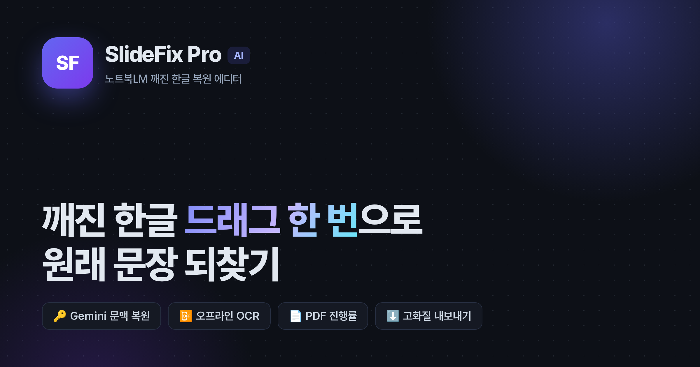

<div align="center">



# SlideFix Pro

**이미지·PDF 파일 속 깨진 한글과 오타를 드래그 한 번으로 고치는 웹 에디터**

설치 없이 브라우저에서 바로 실행되는 단일 HTML 앱입니다.

</div>

---

## 무엇을 하나요?

이미지로 공유받은 슬라이드·인포그래픽이나 PDF 문서는 한글이 `□`, `?`, 깨진 자모로 뭉개지거나 오타가 섞여 있는 경우가 있습니다.
SlideFix Pro는 그 부분만 드래그하면 **문맥을 읽고 원래 문장을 복원**해, 원본 위에 자연스럽게 덮어 그려 줍니다.

- **원본 스타일 근사치 자동 추정** — 드래그한 영역(또는 AI 자동 탐지 영역)의 실제 글자 잉크를 재서 **글자 크기·굵기·색상·정렬**을 원본과 비슷하게 맞추고, 배경도 주변 색을 **가장 많은 색 무리(mode)** 로 읽어 회색 띠 없이 채웁니다
- 글꼴·자간·줄간격은 패널에서 직접 조정
- 결과는 PNG·JPG·다중 페이지 PDF로 바로 내보내기

## 주요 기능

| 구분 | 기능 |
| --- | --- |
| 불러오기 | PNG · JPG · WebP · PDF(다중 페이지), 여러 파일 동시 선택 |
| PDF | 페이지별 변환 진행률 표시, 고화질 래스터화, 슬라이드 목록으로 이동 |
| AI 복원 | **Gemini 문맥 복원** — 선택 영역의 문맥을 읽어 자연스러운 한국어로 복원하고, 무엇이 어떻게 고쳐졌는지 메모를 남깁니다 · **AI 사용 ON/OFF 토글**(키는 보관한 채 오프라인 OCR로 전환 가능) |
| AI 자동 탐지 | 슬라이드 전체에서 깨진 글자 영역을 찾아 한 번에 복원 |
| 오프라인 OCR | **API 키 없이도** Tesseract.js(한국어+영어)로 선택 영역 글자 인식 · 첫 실행 시 인식 모델을 내려받습니다 |
| 편집 | 텍스트 레이어 이동·크기 조절, 스포이드 색 추출(캔버스 픽셀 방식), 굵기·자간·줄간격, 영역 가이드(모든 수정 영역 위치를 점선으로 보기) |
| 스타일 자동 추정 | 박스 안 실제 글자 잉크 높이로 폰트 크기 역산 · 잉크 밀도로 굵기(400~800) 선택 · 대비 최대 픽셀로 글자색 · 여러 줄 가운데 정렬 판별 · 박스를 잉크에 딱 맞춰 원본 잔상 제거 (드래그·AI 자동 탐지 공통) |
| 배경 | 스마트 자동 복원(배경 무리 mode + 옅은 그라데이션 판별), 지정 단색 채우기, 투명 배경 |
| 내보내기 | 현재 슬라이드 PNG(고화질) · JPG(경량) · 전체 슬라이드 PDF |
| 화면 | 다크/라이트 테마, 원본 비교, 확대·축소·맞춤, 모바일 **선택/이동 모드 토글**(손가락으로는 화면 이동, 펜·마우스로는 영역 지정) |

## 사용법

1. **파일 열기**로 슬라이드 이미지나 PDF를 불러옵니다.
2. 깨진 글자가 보이는 영역을 마우스(또는 펜)로 드래그합니다.
   - 🔑 **AI 사용이 켜져 있으면** → Gemini가 문맥에 맞게 복원합니다.
   - **AI 사용이 꺼져 있거나 키가 없으면** → 오프라인 OCR로 글자를 인식합니다. (AI를 꺼도 키는 지워지지 않고 보관됩니다)
3. 오른쪽 패널에서 글꼴·크기·색·배경 지우기 방식을 다듬습니다.
4. **내보내기**로 PNG·JPG·PDF를 저장합니다.

### 화면 안내

- 드래그로 영역을 잡으면 AI 사용 여부와 관계없이 **수정 메뉴(오른쪽 인스펙터 · 플로팅 퀵바)가 열린 채로 유지**되어 바로 글자·스타일을 다듬을 수 있습니다.
- **선택 점선**은 편집 중인 영역을 알려 줍니다. **✓ 편집 완료** 버튼, 패널의 **✕ 닫기**, 캔버스 **빈 곳 클릭**, `Esc`, **🧹 글자 지우기**로 없앨 수 있습니다.
- 하단 **영역 가이드**는 화면에 보이는 모든 수정 영역의 위치를 점선으로 보여 줍니다. 위치를 확인하는 화면 전용 표시라 **저장·내보내기 결과물에는 들어가지 않습니다.**
- **✋ 이동** 모드에서는 손가락(또는 마우스)으로 슬라이드를 끌어 확대한 화면의 네 방향 끝까지 이동할 수 있습니다.

### 단축키

| 키 | 동작 |
| --- | --- |
| `Drag` | 새 수정 영역 추가 및 AI 복원 |
| `빈 곳 클릭` / `Esc` | 선택 해제 |
| `Delete` | 선택한 영역만 삭제 |
| `Space` (길게) | 원본 슬라이드 보기 |
| `Ctrl + Z` / `Ctrl + Y` | 실행 취소 / 다시 실행 |

## Gemini API 키 (선택)

AI 문맥 복원과 전체 자동 탐지에만 쓰입니다. 없어도 오프라인 OCR로 기본 동작합니다.

1. 상단 **🔑 AI 키** 버튼 → [Google AI Studio](https://aistudio.google.com/app/apikey)에서 발급한 키 입력 → 저장
2. 키는 **이 브라우저의 `localStorage`(`slidefix_gemini_key`)에만** 저장되고, 복원을 요청할 때만 Google Gemini API로 전송됩니다. 서버로 보내거나 저장하는 곳은 없습니다.
3. 공용 PC에서는 등록하지 마세요. **키 삭제** 버튼으로 언제든 지울 수 있습니다.
4. 같은 창의 **AI 문맥 복원 사용** 스위치로 AI 사용을 켜고 끕니다. 끄면 키를 지우지 않은 채 오프라인 OCR로 동작하고, 상단 버튼이 **AI 꺼짐(노란 점)** 으로 표시됩니다.

## 실행 · 배포

정적 파일 하나(`index.html`)로 동작합니다. 빌드 과정이 없습니다.

```bash
# 로컬에서 확인
python3 -m http.server 8080
# → http://localhost:8080
```

- **Vercel**: 이 저장소를 그대로 Import → Framework Preset `Other`, Build Command 없음, Output Directory `.` → Deploy
- **GitHub Pages / Netlify / Cloudflare Pages**: 정적 호스팅에 그대로 올리면 됩니다.

> 배포 도메인이 정해지면 `<head>`의 `og:image`·`twitter:image`를 절대 주소(`https://도메인/og-image.png`)로 바꾸고 `og:url`을 추가해 주세요. 카카오톡·페이스북 미리보기 카드가 더 확실하게 표시됩니다.

## 기술 스택

- HTML + Tailwind CSS(CDN) + Vanilla JS — 프레임워크·번들러 없음
- [PDF.js](https://mozilla.github.io/pdf.js/) — PDF → 캔버스 변환
- [jsPDF](https://github.com/parallax/jsPDF) — 다중 페이지 PDF 내보내기
- [Tesseract.js](https://tesseract.projectnaptha.com/) — 오프라인 한국어·영어 OCR
- Google Gemini API (`generateContent`) — 문맥 복원 · 깨진 글자 자동 탐지
- Pretendard · Google Fonts — 한국어 웹폰트

## 브라우저

Chrome · Edge · Safari · Firefox 최신 버전, Android/iOS 모바일 브라우저에서 동작합니다.
첫 실행 시 CDN에서 라이브러리와 OCR 모델을 내려받으므로 인터넷 연결이 필요합니다.

## 개인정보

- 슬라이드 이미지는 서버로 업로드되지 않습니다. 모든 변환·편집은 브라우저 안에서 이뤄집니다.
- 외부로 나가는 것은 ① Gemini API 키를 등록한 경우의 복원 요청 ② CDN 라이브러리·폰트 로드뿐입니다.
